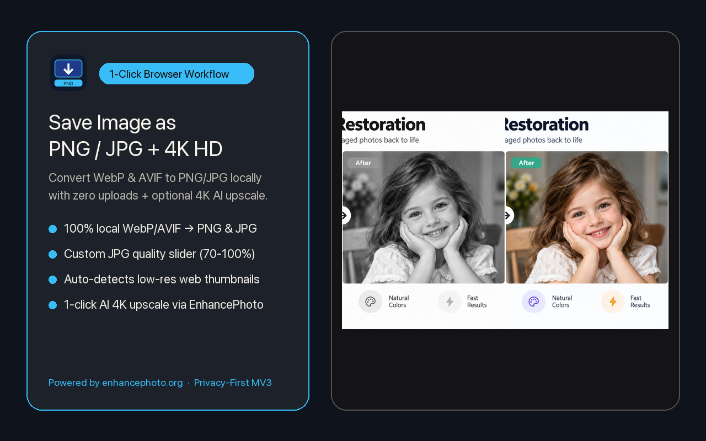

# Save Image as PNG / JPG + HD Upscaler

[](LICENSE)
[](manifest.json)
[](background.js)
[](#installation)

A **zero-dependency, 100% local Manifest V3 browser extension** to right-click any **WebP** or **AVIF** image on the web and save it directly as **PNG**, **JPG**, or **WebP** using `OffscreenCanvas` — with built-in `<800px` low-resolution detection and an optional 1-click **AI 4K Upscale** handoff to **[EnhancePhoto.org](https://enhancephoto.org/image-upscaler)**.


---

## Why This Extension?

Modern websites serve images as `.webp` or `.avif` to save bandwidth, which frequently breaks everyday tools (older Photoshop versions, PowerPoint, Keynote, Word, print shops, and CMS uploaders).

- **100% Local Format Conversion**: Uses native browser `createImageBitmap` + `OffscreenCanvas` — zero servers, zero uploads, instant downloads.
- **Zero Dependencies & Auditable**: Pure ES2022 JavaScript (`~21 KB` packaged), zero external libraries, zero tracking, zero remote code.
- **Custom JPG Quality & Save-As Control**: Popup includes a 60%–100% JPG quality slider, "Ask where to save" toggle, and a local drag-and-drop converter.
- **Automatic Low-Res Warning (`<800px`)**: Spots blurry thumbnails immediately so you can optionally send them to **[EnhancePhoto 4K Image Upscaler](https://enhancephoto.org/image-upscaler)** in one click.
- **5 Built-In Locales**: English (`en`), Simplified Chinese (`zh_CN`), Traditional Chinese (`zh_TW`), Japanese (`ja`), and Spanish (`es`).



---

## Installation

### Browser Web Stores
- **Chrome Web Store** *(In Review)* — Extension ID `cmakbmcodbhdjgnbkjboigfcbflcpccf`
- **Firefox Add-ons (AMO)** *(In Review)* — [`save-image-png-jpg-4k`](https://addons.mozilla.org/en-US/firefox/addon/save-image-png-jpg-4k/)
- **Microsoft Edge Add-ons** *(In Review)* — Store listing pending certification

### Load Unpacked from Source (Chrome / Edge / Brave / Arc)

```bash
git clone https://github.com/yangjwlove-dev/save-image-as-png-jpg.git
```

1. Open `chrome://extensions` (or `edge://extensions`).
2. Enable **Developer mode** (top right).
3. Click **Load unpacked** and select the cloned `save-image-as-png-jpg` folder.

### Build Release ZIPs (Chrome/Edge + Firefox)

```bash
./scripts/build-zips.sh
# Outputs:
#   dist/save-image-as-png-jpg-chrome-edge.zip
#   dist/save-image-as-png-jpg-firefox.zip
```

---

## Permissions Explained

| Permission | Exact Purpose |
| :--- | :--- |
| `contextMenus` | Adds right-click image actions (*Save as PNG*, *Save as JPG*, *Save as WebP*, *AI Upscale to 4K*). |
| `downloads` | Saves the locally converted file into your Downloads folder. |
| `storage` | Persists JPG quality preference and temporarily hands off a single chosen image only if you click *AI Upscale to 4K*. |
| `http://*/*`, `https://*/*` | Fetches the exact image URL you right-click without third-party CDN CORS errors so `OffscreenCanvas` can convert it locally. |

See [PRIVACY.md](PRIVACY.md) for the full privacy policy.

---

## Related Projects
- **[Awesome AI Photo Restoration Prompts](https://github.com/yangjwlove-dev/awesome-ai-photo-restoration-prompts)** — 36 battle-tested prompts + installable Agent Skill for old photo restoration, deblurring, 4K upscaling, and B&W colorization.
- **[EnhancePhoto.org](https://enhancephoto.org/)** — Online AI Photo Enhancer, [4K Image Upscaler](https://enhancephoto.org/image-upscaler), and [Old Photo Restoration](https://enhancephoto.org/photo-restoration).

## License

[MIT](LICENSE)
