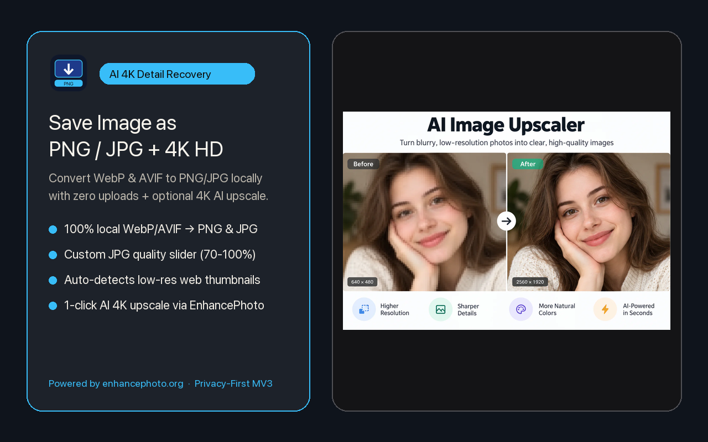

# Save Image as PNG / JPG + HD Upscaler

[](LICENSE)
[](manifest.json)
[](background.js)

Zero-dependency Manifest V3 browser extension to right-click any **WebP** or **AVIF** image and save it as **PNG**, **JPG**, or **WebP** — 100% locally via `OffscreenCanvas`, with `<800px` low-res detection and an optional 1-click AI upscale handoff to [EnhancePhoto](https://enhancephoto.org/).



## What It Does

- **Right-click conversion (100% offline)**: Converts WebP/AVIF/PNG/JPG locally using `createImageBitmap` + `OffscreenCanvas`. Zero uploads, zero tracking, ~21 KB total.
- **Popup converter & controls**: Adjust JPG quality (60%–100%), toggle "Save As" prompts, or drag-and-drop local files to convert offline.
- **Low-res warning (`<800px`)**: Flags small thumbnails and lets you optionally send them to [EnhancePhoto 4K upscaler](https://enhancephoto.org/image-upscaler) in one click.
- **5 locales built in**: `en`, `zh_CN`, `zh_TW`, `ja`, `es`.


## Install

### From Source (Chrome / Edge / Brave / Arc)

```bash
git clone https://github.com/yangjwlove-dev/save-image-as-png-jpg.git
```

1. Open `chrome://extensions` (or `edge://extensions`) and enable **Developer mode**.
2. Click **Load unpacked** and pick the `save-image-as-png-jpg` folder.

### Build Store ZIPs (Chrome/Edge + Firefox)

```bash
./scripts/build-zips.sh
# Creates dist/save-image-as-png-jpg-chrome-edge.zip and dist/save-image-as-png-jpg-firefox.zip
```

### Browser Stores *(Currently in Review)*
- **Chrome Web Store**: ID `cmakbmcodbhdjgnbkjboigfcbflcpccf`
- **Firefox Add-ons (AMO)**: [`save-image-png-jpg-4k`](https://addons.mozilla.org/en-US/firefox/addon/save-image-png-jpg-4k/)
- **Microsoft Edge Add-ons**: Pending certification

## Permissions & Privacy

| Permission | Purpose |
| :--- | :--- |
| `contextMenus` | Adds right-click Save as PNG / JPG / WebP / AI Upscale options. |
| `downloads` | Saves the converted file to your Downloads folder. |
| `storage` | Saves JPG quality preference and temporarily buffers an image only if you click AI Upscale. |
| `http://*/*`, `https://*/*` | Fetches the specific image URL you right-click without CDN CORS errors so `OffscreenCanvas` can convert it locally. |

Full privacy policy: [PRIVACY.md](PRIVACY.md).

## Related

- [awesome-ai-photo-restoration-prompts](https://github.com/yangjwlove-dev/awesome-ai-photo-restoration-prompts) — 36 photo restoration/upscaling prompts + installable Agent Skill.
- EnhancePhoto web app ([visit the web app](https://enhancephoto.org/)) — optional online AI upscaling & photo restoration.

## License

[MIT](LICENSE)
